# Fabrication of the 8-bit computer boards

[🇧🇷 Português](README.md) · [🇺🇸 English](README.en.md)

---

## Bus simulator

The bus simulator board was manufactured using the team's limited prior knowledge of PCB fabrication. At the time, we were unfamiliar with alternative etching methods, so we chose to remove all the copper surrounding the traces, leaving only the areas required for the electrical connections.

This method resulted in a longer etching time due to the larger amount of copper that needed to be removed. Furthermore, the remaining traces became more fragile because of their longer exposure to the etching process.

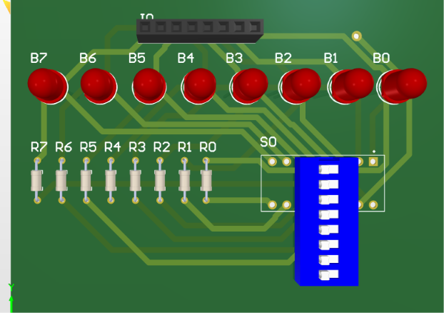

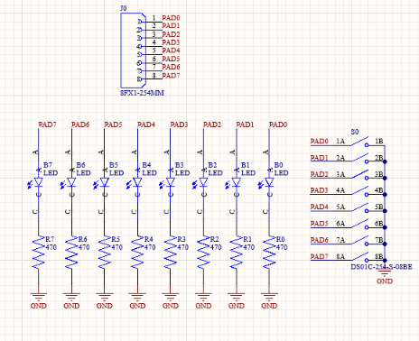

---

## Program counter (PC)

During the fabrication of the program counter (PC) board, we encountered some difficulties related to the PCB design process. Due to a lack of initial guidance, we were unaware that we should use the Top layer instead of the Bottom layer. As a result, we mirrored the wrong layer, compromising the previous work on trace placement, which had been designed to prevent traces from running underneath the integrated circuits (ICs), making soldering easier.

After some time, we managed to identify the problem and correct our procedure. Despite this setback, the experience contributed to the team's learning process.

We also started using the Polygon Pour tool in Eagle, which allows specific areas to be filled with copper, reducing the amount of material that needs to be removed during the etching process.

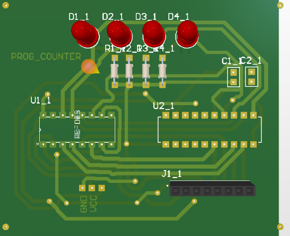

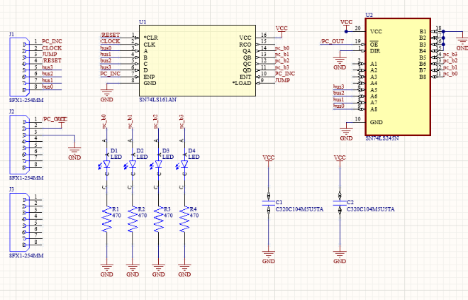

---

## Clock

The fabrication of the clock board was one of the most challenging stages of the process. Although the PCB design itself presented no errors, we encountered difficulties during component soldering. Some soldering failures compromised our progress, requiring corrections and rework.

As the activities progressed, we gradually improved our soldering techniques and, consequently, the overall quality of our work.

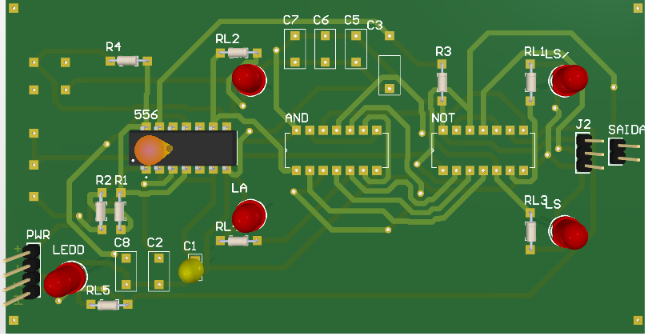

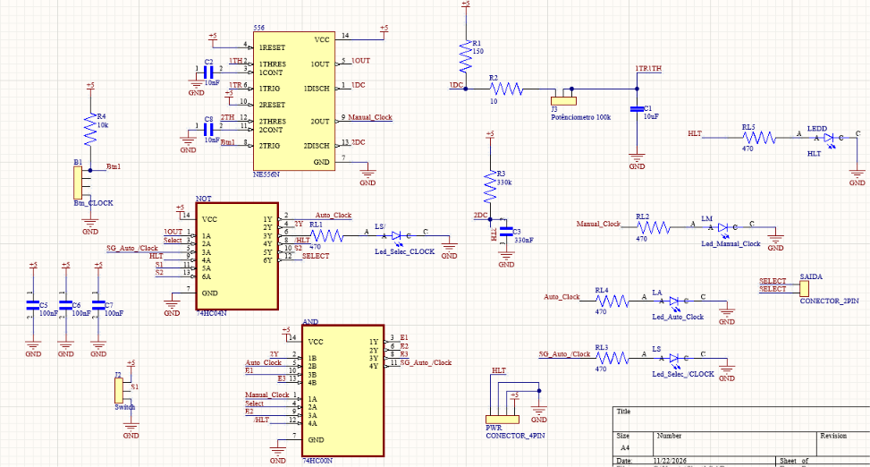

---

## Register

The fabrication of the register board was relatively straightforward, since the design consisted of four modules. However, additional connections had to be made using jumper wires due to a missing connection in the original design.

The soldering process was relatively quick and simple, resulting in one of the best outcomes achieved by the team during the board fabrication process.

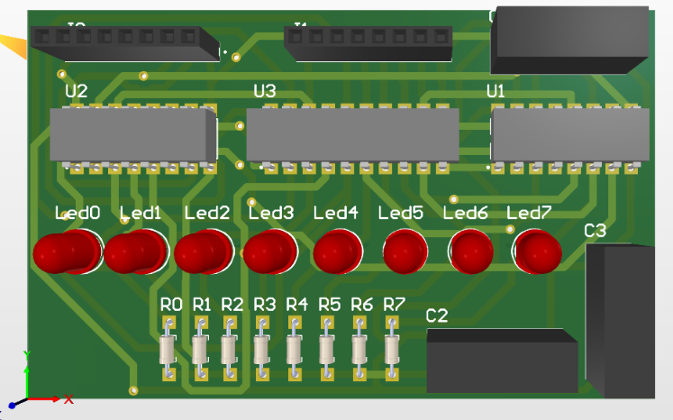

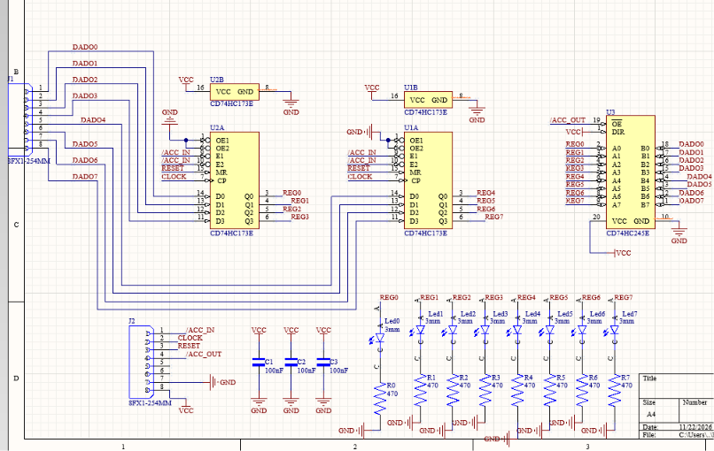

---

## RAM memory

The fabrication of the RAM board was also relatively straightforward, with no major difficulties during the manufacturing and assembly stages.

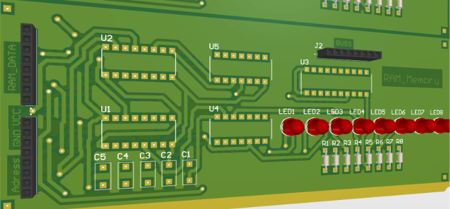

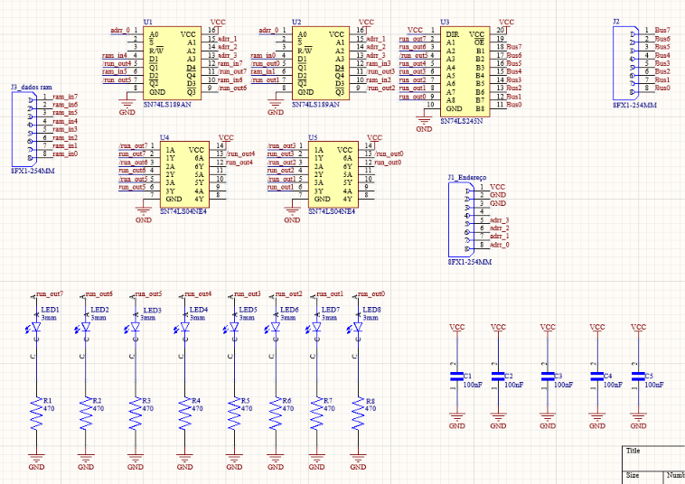

---

## MAR (Memory Address Register)

The MAR board was one of the most complex projects, mainly due to the large variety of components and the difficulty of rearranging the traces to fit the available space.

Despite the complexity of the design, the etching process was successfully completed. Initially, we expected difficulties due to the large copper area on the board. However, using the Polygon Pour tool in Eagle made the process easier.

Although the PCB fabrication was successful, the board was not soldered because some of the components required for its assembly were missing.

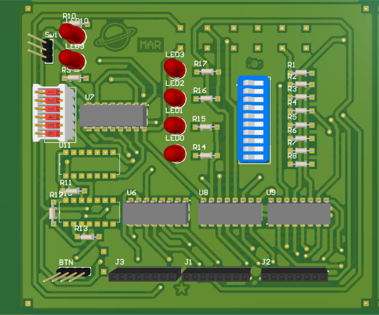

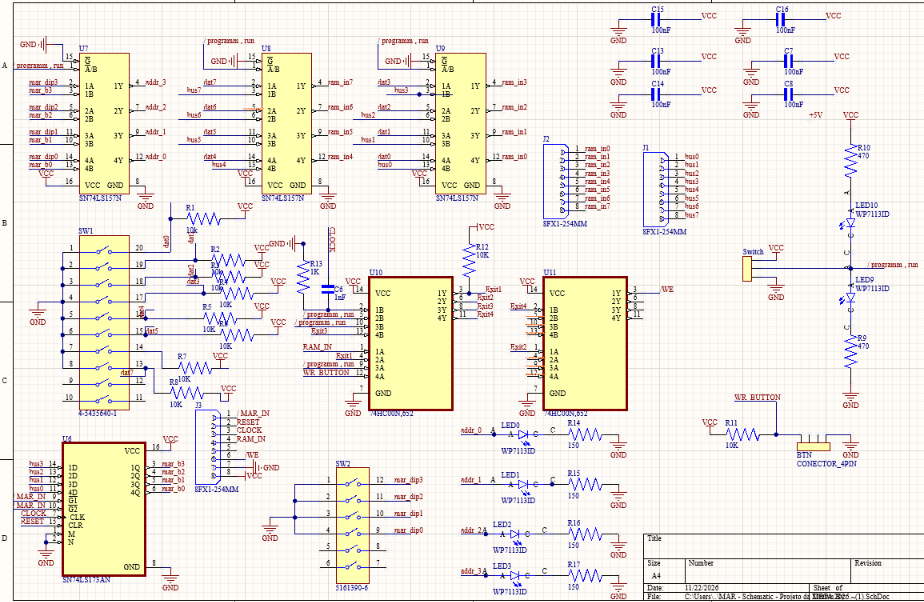
