# Fabricação das placas do computador de 8 bits

[🇧🇷 Português](README.md) · [🇺🇸 English](README.en.md)

---

## Simulador de barramento

A placa do simulador de barramento foi confeccionada utilizando os conhecimentos prévios da equipe sobre a fabricação de PCBs. Na época, por ainda não conhecermos outros métodos de corrosão, optamos por remover todo o cobre ao redor das trilhas, mantendo apenas as regiões necessárias para as conexões.

Esse método apresentou um tempo de corrosão maior, devido à maior quantidade de cobre a ser removida. Além disso, as trilhas resultantes ficaram mais frágeis, em razão do maior tempo de exposição ao processo de corrosão.

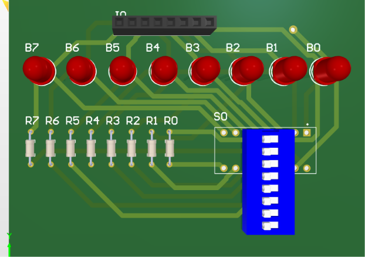

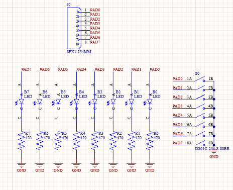

---

## Contador de programa (PC)

Durante a fabricação da placa do contador de programa (PC), enfrentamos algumas dificuldades relacionadas ao processo de desenvolvimento da PCB. Por falta de orientação inicial, não sabíamos que deveríamos utilizar a camada Top em vez da Bottom. Como consequência, espelhamos a camada incorreta, comprometendo o trabalho realizado no posicionamento das trilhas, que havia sido planejado para evitar conexões sob os circuitos integrados (CIs), facilitando posteriormente o processo de soldagem.

Após algum tempo, conseguimos identificar o problema e corrigir nosso procedimento. Apesar do contratempo, a experiência contribuiu para o aprendizado da equipe.

Também passamos a utilizar a ferramenta Polygon Pour do Eagle, que permite preencher determinadas regiões com cobre, reduzindo a quantidade de material que precisa ser removida durante a corrosão.

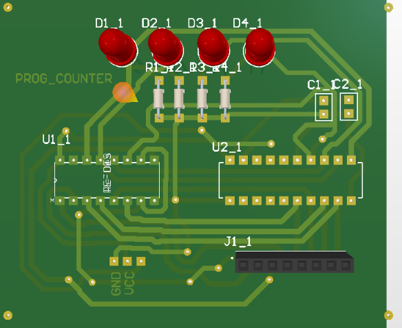

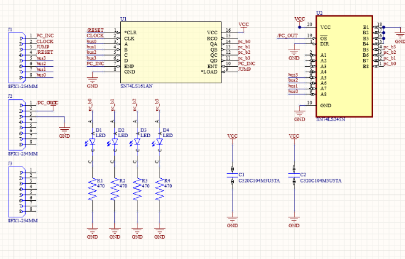

---

## Clock

A confecção da placa do clock foi uma das etapas mais difíceis do processo. Embora o projeto da PCB não tenha apresentado erros, tivemos dificuldades durante a soldagem dos componentes. Algumas falhas nas soldas comprometeram o progresso da montagem, exigindo correções e retrabalho.

Com o decorrer das atividades, fomos aprimorando nossas técnicas de soldagem e, consequentemente, melhorando a qualidade do trabalho realizado.

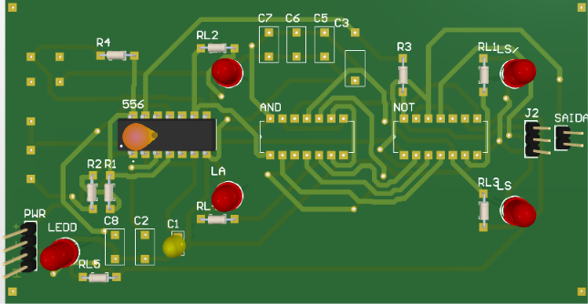

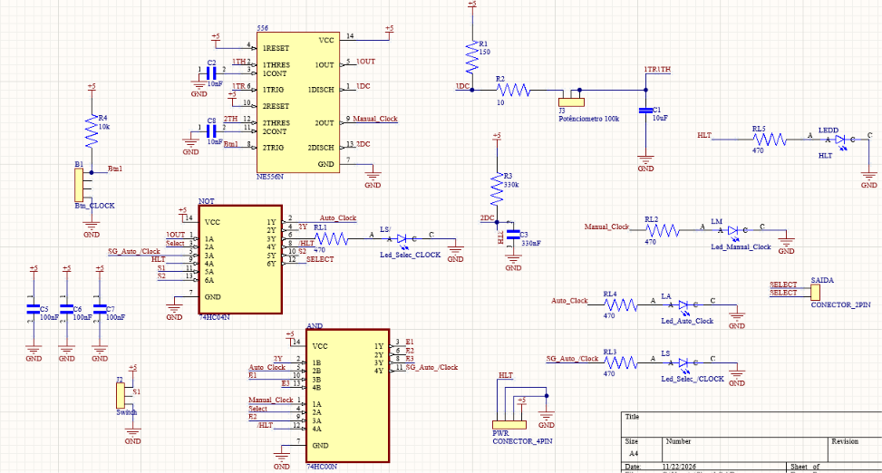

---

## Registrador

A confecção da placa do registrador foi relativamente simples, uma vez que o projeto era composto por quatro módulos. No entanto, foi necessário realizar algumas conexões adicionais por meio de jumpers, devido à ausência de uma conexão no projeto original.

O processo de soldagem foi relativamente rápido e simples, apresentando um dos melhores resultados obtidos pela equipe durante a fabricação das placas.

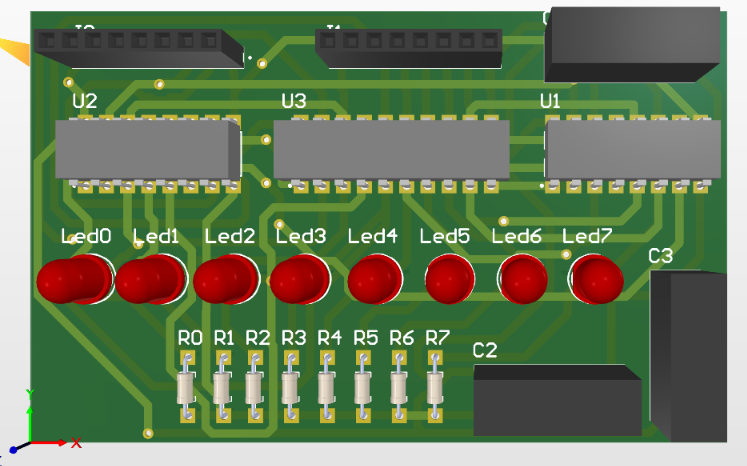

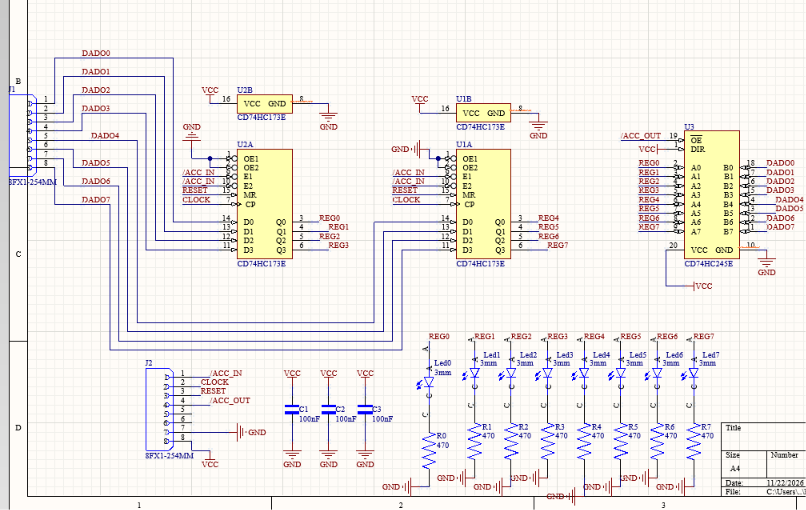

---

## Memória RAM

A fabricação da placa da memória RAM também ocorreu de maneira relativamente simples, sem grandes dificuldades durante as etapas de confecção e montagem.

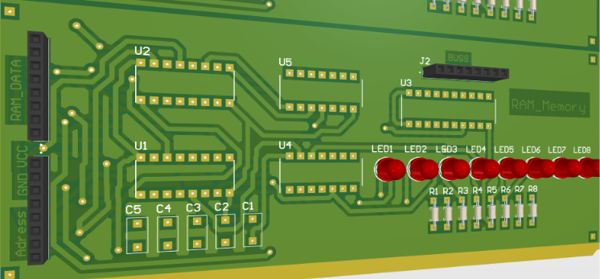

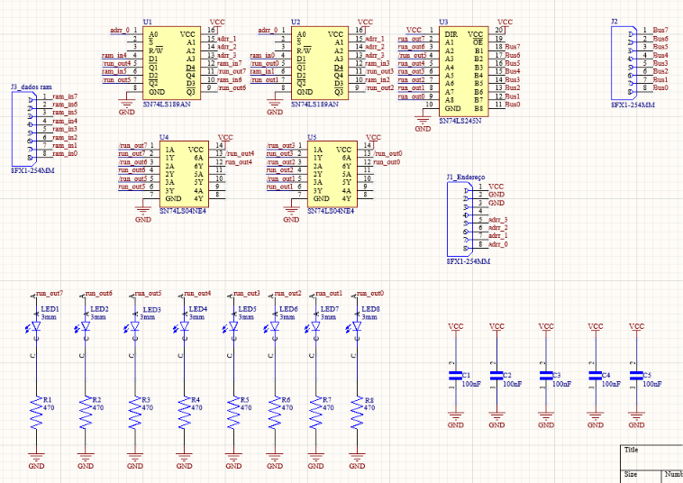

---

## MAR(Registrador de endereço de memória)

O projeto da placa do MAR foi um dos mais complexos, principalmente devido à grande variedade de componentes e à dificuldade de reorganizar as trilhas para adequá-las ao espaço disponível.

Apesar da complexidade do projeto, o processo de corrosão foi realizado com sucesso. Inicialmente, esperávamos encontrar dificuldades devido à grande área de cobre presente na placa. Entretanto, a utilização da ferramenta Polygon Pour, no Eagle, facilitou o processo.

Apesar do sucesso na fabricação da PCB, a placa não chegou a ser soldada devido à falta de alguns componentes necessários para sua montagem.

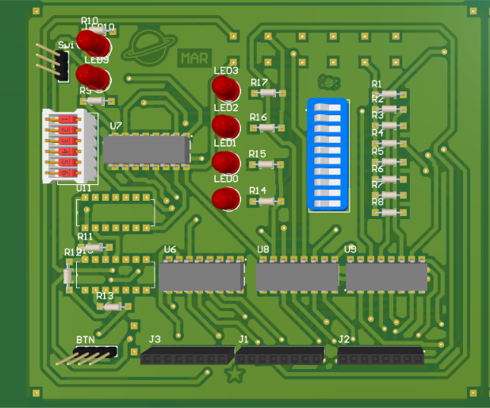

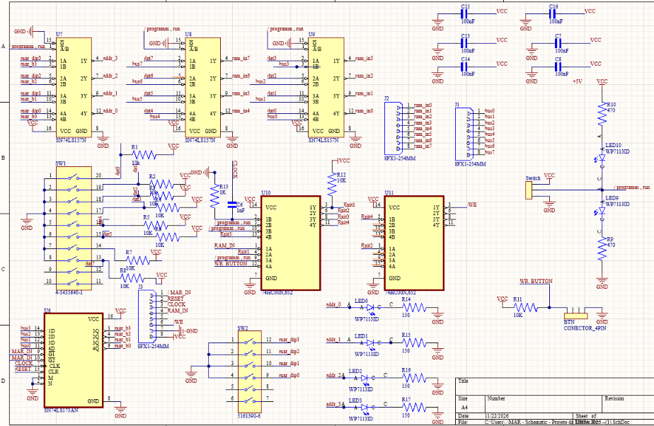
